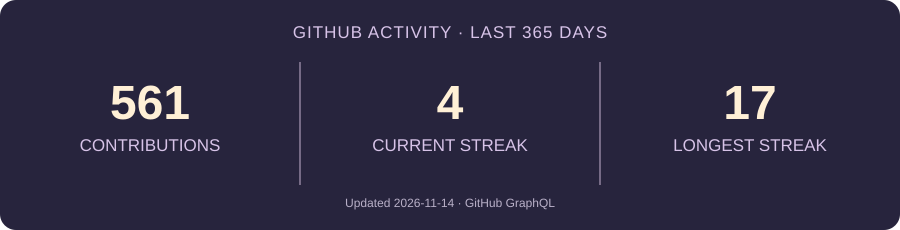

<!-- Original pastel pixel-art banner -->
<div align="center">
  
  <br/>
  
  <br/>
  
  
</div>

---

## ✦ PLAYER PROFILE

```text
┌────────────────────────────────────────────────────────────┐
│  PLAYER   Sanskar                                          │
│  CLASS    Computer Engineering                             │
│  QUEST    Learn → Build → Improve                          │
│  FOCUS    C++ · DSA · Cybersecurity                        │
│  STATUS   Online / always curious                          │
└────────────────────────────────────────────────────────────┘
```

- 🎓 Second-year Computer Engineering student at **D. Y. Patil Institute of Technology, Pimpri**
- 🧩 Solving **Data Structures & Algorithms** problems in C++
- 🛡️ Exploring **Cybersecurity**, Linux and how systems work
- 🛠️ Building practical projects and participating in hackathons

## ✦ INVENTORY / TOOLKIT

<div align="center">
  
</div>

## ✦ QUEST LOG / FEATURED PROJECTS

<table>
  <tr>
    <td width="50%" valign="top">
      <h3>🕰️ GitHub Time Machine</h3>
      <p>A visual journey through GitHub activity and coding history.</p>
      <p align="center"><a href="https://github-time-machine-sage.vercel.app"></a> <a href="https://github.com/SanskarArnale-07/github-time-machine"></a></p>
    </td>
    <td width="50%" valign="top">
      <h3>🧭 Career Compass</h3>
      <p>A career exploration platform helping students discover paths through strengths and interests.</p>
      <p align="center"><a href="https://career-compass-six-sand.vercel.app"></a> <a href="https://github.com/SanskarArnale-07/Career-Compass"></a></p>
    </td>
  </tr>
  <tr>
    <td width="50%" valign="top">
      <h3>🌿 LifeAdmin</h3>
      <p>A personal life-management app for keeping everyday admin in one place.</p>
      <p align="center"><a href="https://lifeadmin-web.onrender.com"></a> <a href="https://github.com/Srushti07-del/LifeAdmin"></a></p>
    </td>
    <td width="50%" valign="top">
      <h3>📘 ProofLoop</h3>
      <p>An evidence-driven career project connecting skills to demonstrable proof of work and actionable improvement plans.</p>
      <p align="center"><a href="https://proofloop-sand-six.vercel.app/"></a> <a href="https://github.com/SanskarArnale-07/ProofLoop"></a></p>
    </td>
  </tr>
</table>

## ✦ ACHIEVEMENTS / CHECKPOINTS

- 🧩 **100+** DSA problems solved
- 🛠️ **Technical Head**, ACM Student Chapter
- 🛡️ Exploring cybersecurity through hands-on learning

## ✦ SAVE POINT / GITHUB ACTIVITY

<div align="center">
  
  <br/>
  
</div>

---

<div align="center">

**☁️ THANKS FOR VISITING MY LITTLE CORNER OF THE INTERNET**

<a href="https://github.com/SanskarArnale-07">[ GITHUB ]</a> &nbsp; <a href="https://www.linkedin.com/in/sanskar-arnale-4b66ba380/">[ LINKEDIN ]</a> &nbsp; <a href="mailto:sanskararnale07@gmail.com">[ EMAIL ]</a>

<sub>made with curiosity, thoughtful experiments & a little persistence ✦</sub>

</div>
